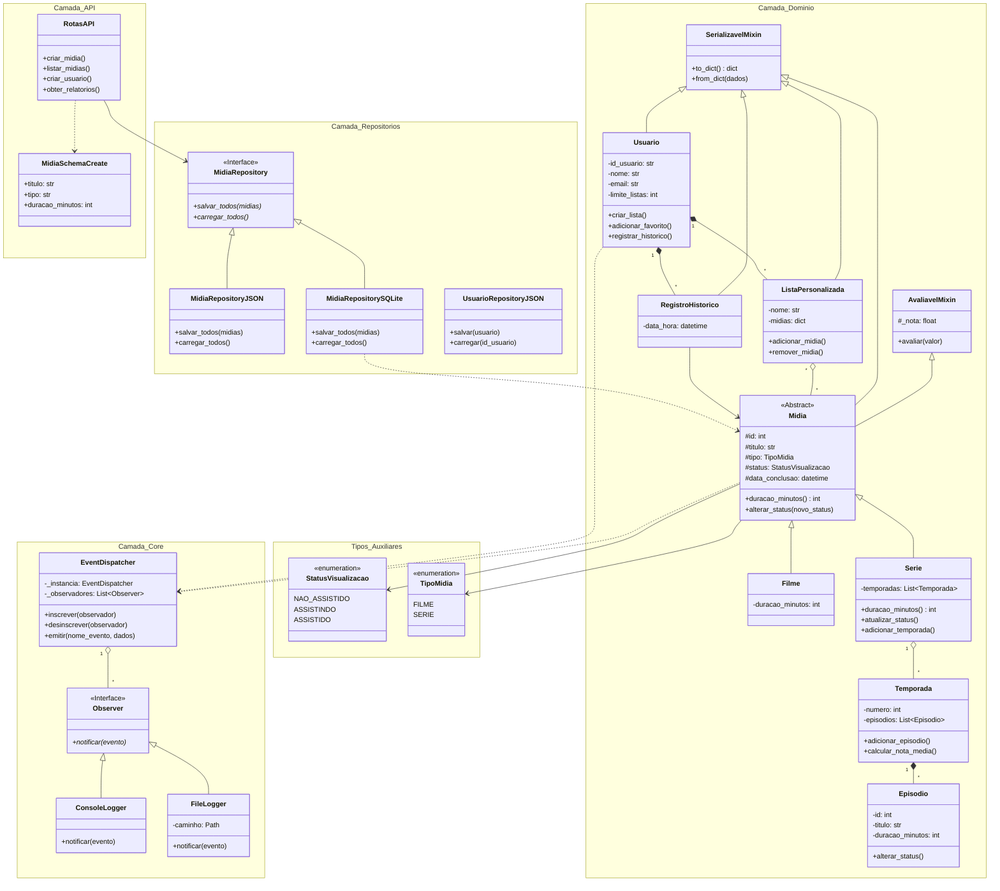

```markdown
# Catálogo de Filmes e Séries

## 📌 Visão Geral

Este projeto consiste numa aplicação robusta orientada a objetos (POO) desenvolvida em Python para a gestão de um catálogo pessoal de filmes e séries[cite: 1, 6]. O sistema permite acompanhar o progresso de visualização, gerir episódios e temporadas, avaliar mídias, organizar listas personalizadas e consultar estatísticas e relatórios avançados de consumo[cite: 1, 6].

A arquitetura adota o padrão **`src-layout`**, separando com clareza as camadas de domínio, persistência, regras de negócio e interface[cite: 1, 6].

---

## 🛠️ Decisões de Arquitetura & Padrões de Projeto

### 1. Modelação Orientada a Objetos (POO)
- **Hierarquia de Domínio e Polimorfismo**: A classe abstrata `Midia` estabelece o contrato para `Filme` e `Serie`[cite: 1, 7, 10, 17]. Métodos abstratos como `duracao_minutos` garantem que cada subclasse calcule a sua duração adequadamente (duração fixa em filmes vs. soma dinâmica das temporadas e episódios em séries)[cite: 6, 7, 17].
- **Composição e Agregação**: A classe `Serie` compõe `Temporada`, que por sua vez contém instâncias de `Episodio`[cite: 6, 7]. A integridade das relações é mantida através de métodos dedicados (`adicionar_temporada`, `adicionar_episodio`)[cite: 6, 17].
- **Encapsulamento Rígido**: Todos os atributos de estado interno são protegidos (prefixo `_`) e expostos via `@property` e `@setter` com validações prévias de intervalo, tipo e formatação (ex.: notas restritas a $0.0 - 10.0$, títulos não vazios, tempos positivos)[cite: 1, 2, 7, 15, 16, 17].
- **Métodos Especiais (Dunder Methods)**:
  - `__eq__`: Comparação de mídias por ID ou combinação única de Título + Tipo + Ano[cite: 6, 7, 17].
  - `__lt__`: Ordenação automática de mídias com base na avaliação[cite: 7, 17].
  - `__len__`: Contagem total de episódios em instâncias de `Serie` e mídias contidas em `ListaPersonalizada`[cite: 7, 15].
  - `__str__` / `__repr__`: Exibição formatada e detalhada de representação das entidades[cite: 7, 15, 17].

### 2. Padrão Observer (Log de Eventos Desacoplado)
Para estender a aplicação com auditoria e logs sem acoplar I/O ou manipulação de ficheiros às entidades de domínio, foi implementado o padrão **Observer**[cite: 5, 12, 13]:
- **`EventDispatcher` (Subject/Singleton)**: Gerencia centralizadamente as inscrições dos observadores e a emissão de eventos no sistema[cite: 12].
- **Observadores Concretos (`ConsoleLogger`, `FileLogger`)**: O `ConsoleLogger` imprime notificações em tempo real no terminal, enquanto o `FileLogger` registra eventos estruturados num ficheiro de auditoria local (`data/eventos.log`)[cite: 13].
- **Eventos Disparados**: Alteração de status de visualização (`STATUS_ALTERADO`), avaliação de mídia (`MIDIA_AVALIADA`), criação de listas (`LISTA_CRIADA`) e atualização de histórico (`HISTORICO_REGISTRADO`)[cite: 12, 13, 15, 16, 17].

### 3. Reutilização via Mixins
- **`AvaliavelMixin`**: Encapsula a lógica de atribuição, validação e notificação de notas[cite: 16].
- **`SerializavelMixin`**: Utiliza *reflection* (`inspect.signature`) e inspeção de dicionário interno para converter instâncias complexas (incluindo datas ISO 8601 e Enums) em dicionários primitivos e reconstruí-las via `from_dict`[cite: 16].

### 4. Camada de Persistência Flexível
- Acesso a dados abstraído pela interface `MidiaRepository`[cite: 7, 10].
- Implementação ativa em SQLite (`MidiaRepositorySQLite`) com suporte ORM/Database, permitindo alternância simples para persistência em JSON (`MidiaRepositoryJSON`) configurável no `settings.json`[cite: 1, 4, 7, 11, 14].

### 5. Tratamento de Exceções Customizadas
Definição de exceções específicas de domínio (`ValorInvalidoError`, `EstadoInvalidoError`) em `src/models/exceptions.py`, impedindo que estados inconsistentes sejam propagados[cite: 2, 15, 17].

---

## 🚀 Funcionalidades Principais

- **Cadastro e Impedimento de Duplicados**: Inserção de filmes e séries impedindo mídias duplicadas com o mesmo título, tipo e ano[cite: 1, 6, 8].
- **Conclusão Automática de Séries**: Transição automática da série para `ASSISTIDO` assim que todos os seus episódios forem marcados como concluídos[cite: 1, 6, 8].
- **Listas e Favoritos**: Criação de listas temáticas personalizadas respeitando o limite máximo definido na configuração global (`settings.json`)[cite: 1, 3, 6, 8, 14, 15].
- **Relatórios & Estatísticas de Consumo**:
  - Média de notas por género cinematográfico/televisivo[cite: 1, 6, 7, 8].
  - Tempo total assistido por tipo de mídia, convertido para horas com multiplicador configurável[cite: 1, 6, 7, 14, 17].
  - Ranking Top 10 das mídias com melhores avaliações[cite: 1, 6, 7, 8].
  - Mídias mais assistidas e relatórios de progresso[cite: 1, 6, 7, 8].

---

## 📊 Diagrama de Classes (UML)

<div align="center">
  
</div>

<details>
<summary>🔍 Clique aqui para expandir o código fonte Mermaid</summary>



---

## 📂 Estrutura de Arquivos e Diretórios

```text
catalogo_de_filmes_e_series/
│
├── data/                        # Arquivos de dados persistentes e logs
│   ├── catalogo.db              # Banco SQLite gerado automaticamente
│   └── eventos.log              # Log de auditoria (Observer FileLogger)
│
├── docs/                        # Documentação e artefatos visuais
│   └── mermaid-diagram-2026-10-26-152539.png
│
├── src/                         # Código-fonte principal da aplicação
│   ├── api/                     # Camada de Interface (Endpoints HTTP / FastAPI)
│   │   ├── rotas_midias.py
│   │   ├── rotas_usuarios.py
│   │   └── schemas.py
│   │
│   ├── core/                    # Configurações globais e infraestrutura
│   │   ├── configuracao.py      # Leitor e validador do settings.json
│   │   ├── events.py            # EventDispatcher e interface Observer
│   │   ├── loggers.py           # ConsoleLogger e FileLogger
│   │   └── settings.json        # Arquivo de parâmetros dinâmicos
│   │
│   ├── models/                  # Camada de Domínio (POO)
│   │   ├── enums.py             # Enums StatusVisualizacao e TipoMidia
│   │   ├── exceptions.py        # Exceções personalizadas de domínio
│   │   ├── filme.py             # Entidade Filme
│   │   ├── midia.py             # Classe abstrata base Midia
│   │   ├── mixins.py            # AvaliavelMixin e SerializavelMixin
│   │   ├── serie.py             # Entidades Serie, Temporada e Episodio
│   │   └── usuario.py           # Entidades Usuario, ListaPersonalizada e RegistroHistorico
│   │
│   ├── repositories/            # Camada de Persistência e Repositórios
│   │   ├── database.py          # Conexão ORM / SQLite
│   │   ├── midia_repository.py
│   │   └── usuario_repository.py
│   │
│   └── services/                # Regras de Negócio e Casos de Uso
│       └── relatorio.py         # Cálculos de relatórios estatísticos
│
├── tests/                       # Suíte de testes automatizados (pytest)
│   ├── conftest.py              # Fixtures e banco SQLite em memória
│   ├── test_api.py              # Testes de integração das rotas
│   ├── test_midia.py            # Testes unitários das entidades de domínio
│   └── test_relatorios.py       # Testes dos serviços estatísticos
│
├── main.py                      # Ponto de entrada da aplicação
├── pytest.ini                  # Configuração do pythonpath para os testes
├── requirements.txt             # Dependências do projeto
└── seed.py                      # Script de povoamento inicial do banco de dados

```

---

## ⚙️ Configurações Dinâmicas (`settings.json`)

O sistema lê dinamicamente o arquivo `src/core/settings.json`, permitindo ajustar comportamentos operacionais sem necessidade de recompilação ou alteração do código-fonte:

```json
{
    "nota_minima_recomendado": 8.0,
    "limite_listas_usuario": 10,
    "multiplicador_duracao": 1.0,
    "casas_decimais_tempo": 2,
    "backend_persistencia": "sqlite"
}

```

* **`nota_minima_recomendado`**: Nota de corte para rotular uma mídia como "Recomendada".


* **`limite_listas_usuario`**: Quantidade máxima de listas personalizadas por usuário.


* **`multiplicador_duracao`**: Fator multiplicador para cálculo de tempo total assistido (ex.: conversão de escala).


* **`backend_persistencia`**: Define o motor de dados ativo (`sqlite` ou `json`).


---

## 🛠️ Como Executar o Projeto

### Pré-requisitos

* Python 3.10 ou superior instalado.


### 1. Instalação de Dependências

Clone o repositório e instale as dependências necessárias:

```bash
git clone [https://github.com/edson-santos0077/catalogo-de-filmes-e-series.git](https://github.com/edson-santos0077/catalogo-de-filmes-e-series.git)
cd catalogo-de-filmes-e-series
pip install -r requirements.txt

```

### 2. Povoar o Banco de Dados (`seed.py`)

Para popular a base de dados SQLite com registros iniciais de filmes, séries, episódios e avaliações:

```bash
python seed.py

```

### 3. Executar o Servidor API

Inicie o servidor local FastAPI via Uvicorn:

```bash
uvicorn main:app --reload

```

Acesse a documentação interativa da API em `http://127.0.0.1:8000/docs`.

---

## 🧪 Executando os Testes Automatizados

A suíte de testes utiliza o `pytest` e cobre a criação de objetos, validações de atributos, cálculo de relatórios e regras do Observer:

```bash
py -m pytest -v

```

